# ONXWebStudio

ONXWebStudio is a fully browser-based ESPHome YAML editor for building OpenNextion screens with a visual layout workflow, LVGL-style preview, and browser-side YAML generation.

Use it to:

- Design screen layouts directly in the browser
- Preview an interface that stays close to the final LVGL/ESPHome output
- Generate YAML that can be used with ESPHome

## Preview

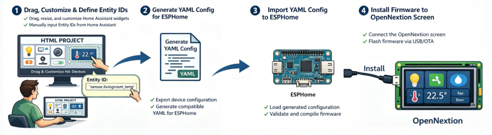

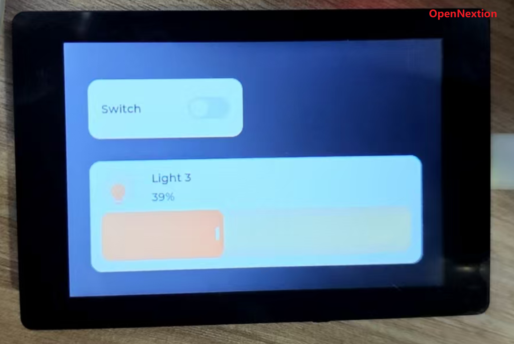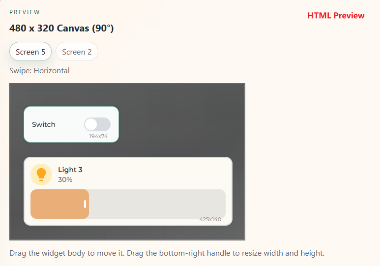

[Demo](assets/videos/readme/video1.mp4)

## Supported components

- `switch` / `multi_switch`
- `thermo_hygrometer`
- `cover`
- `light`
- `hmi_screen_brightness`
- More components still in development......

## Examples

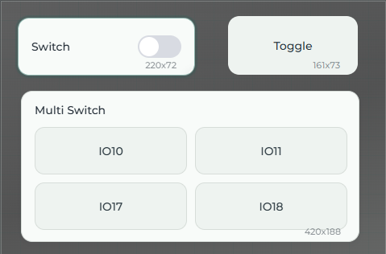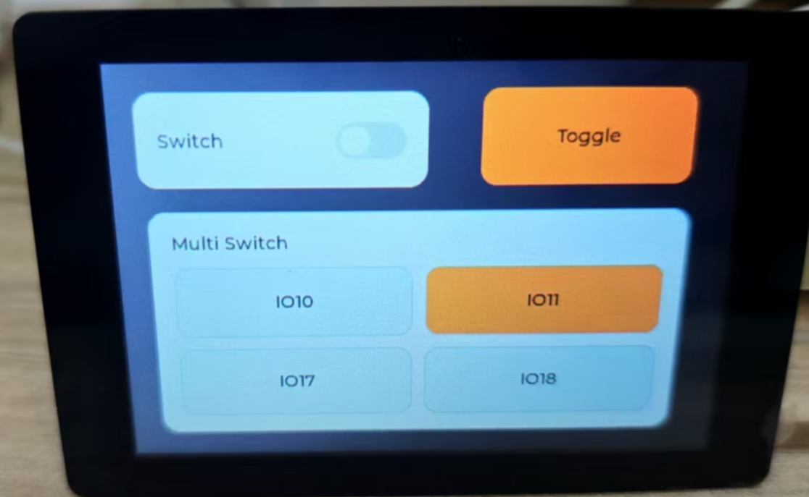

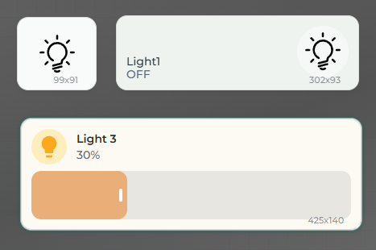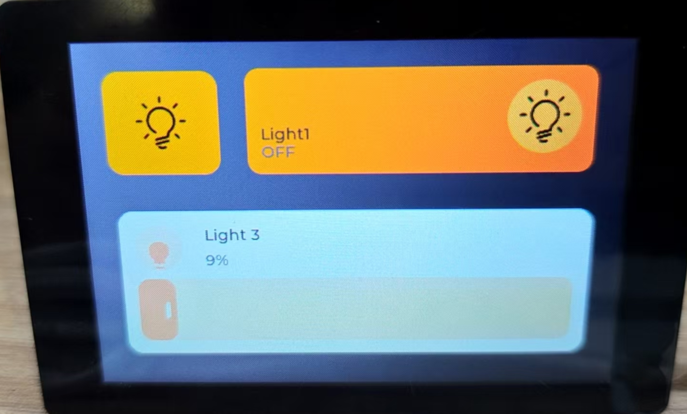

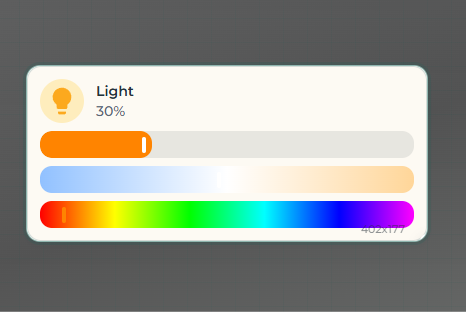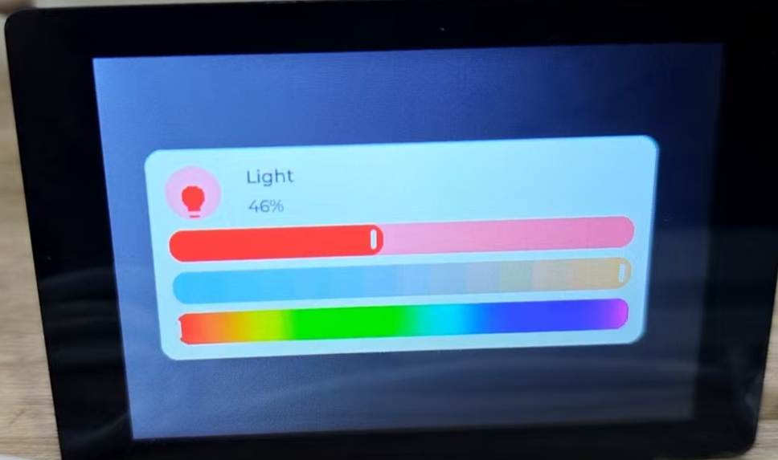

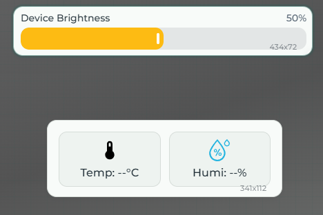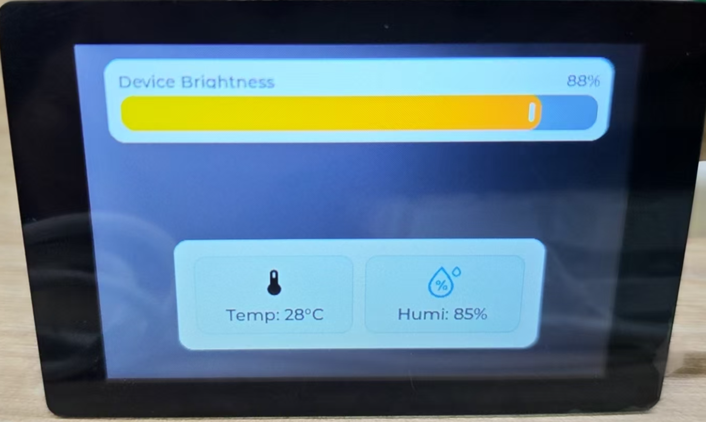

## Quickstart

Read the step-by-step setup guide:

- [QUICKSTART.md](QUICKSTART.md)

If you prefer Chinese:

- [README_cn.md](README_cn.md)

## Online demo

[https://opennextion.github.io/OpenNextion-Example-ESPHome_UI_Designer/](https://opennextion.github.io/OpenNextion-Example-ESPHome_UI_Designer/)